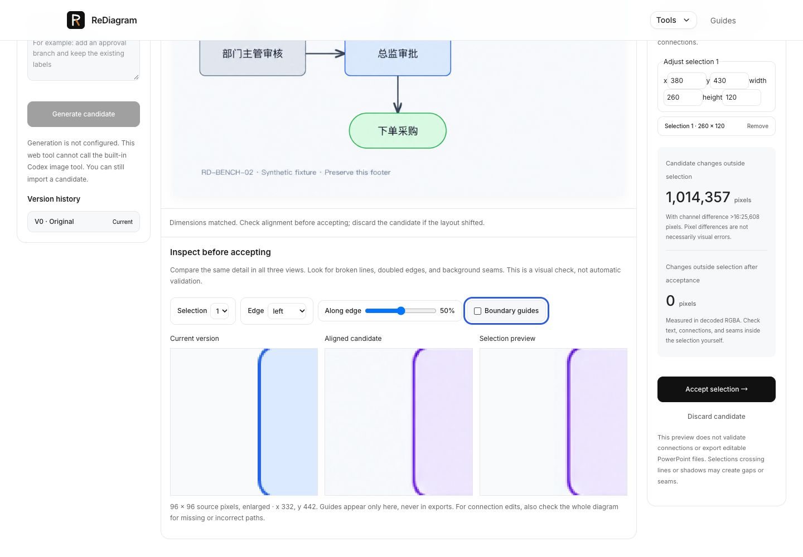
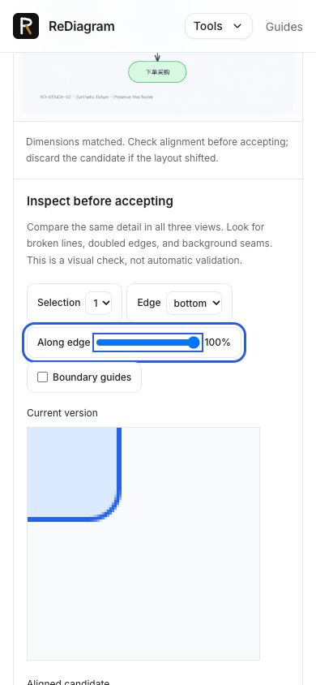

# Boundary inspection and integer alignment

Implemented on the same development branch as Draft PR #59. Neither Fix's processing nor the production gates changed.

## User workflow

Import source → import actual model output → confirm resize → select a region → optionally translate the candidate → inspect the same enlarged boundary in current/candidate/selection-preview views → accept → restore the saved version.

The inspector shows a 96 × 96 source-pixel crop (or the entire image if smaller), enlarged without smoothing. Users select an edge and move along it. Guides can be hidden and are never written into the accepted image. Full-diagram text and relationship review remains necessary.

Alignment translates the candidate by integer pixels, up to ±64 on each axis. It always derives from the imported/resized candidate, avoiding accumulated resampling. Reset restores zero offset. Uncovered pixels appear transparent in the candidate; acceptance is blocked if any selected rectangle includes them. This does not detect or fix per-object layout changes, rotation, scale, texture or color mismatch.

## Evidence

- Browser import used the actual Chinese fixture `source.png` and `candidate.png`, with explicit Canvas resizing from 1254 square to 1024 square.
- Selected Finance at x=380, y=430, width=260, height=120. Edge selection, one-pixel movement, reset, guide hiding, and slider endpoint operation were exercised in the UI.
- With X offset=1 and selection x=0, the coverage warning appeared and **Accept selection** was disabled. Resetting alignment restored eligibility.
- A +1 X offset increased outside high-contrast candidate differences from 25,608 to 35,708 in this example. We reset it to zero; manual translation is optional and is not advertised as an automatic improvement.
- Desktop (1440px) and narrow (390px) layouts were visually checked. The inspector stacks on narrow screens; the logo/navigation remain consistent. Temporary viewport settings were reset.
- Finance changes were accepted as V1. After a browser automation interruption, reopening **source.png · 2 versions** from Recent projects restored V0 and V1.
- [Persisted browser PNG](./browser-accepted-finance.png) was read from the rendered current-version image after restoration. Independent decoding found **0 changed pixels outside the selection** and 31,153 changed pixels inside. See [audit metadata](./browser-acceptance-audit.json). This image contains only the accepted Finance edit; it intentionally retains the source branch relationships.
- The download-event automation stalled and its tab disappeared. The later project-export UI acknowledged export, but no new downloaded file was recovered. **Download completion is not newly verified by this iteration.** The persisted-image audit is distinct from a downloaded-file audit; prior English-demo download evidence remains historical.
- Four new tests cover all translation quadrants and RGBA channels, invalid offsets, uncovered selections, acceptance preservation, crop bounds, and an independently displaced real model fixture. The known +3/-2 displacement is exactly restored within the Finance region using -3/+2. This controlled case proves translation behavior, not automatic alignment of arbitrary model output.
- Total focused automated coverage: 13 tests. Scoped TypeScript passes. Whole-repository baseline type issues remain documented in the parent README.

## Evaluation still needed before charging

This iteration makes defects easier to inspect and rigid offsets correctable. It does not prove that users finish faster than with direct model editing. Use the proposed gates in [RESULTS.md](./RESULTS.md) and record task outcomes with [task-results.csv](./task-results.csv). The CSV is an empty recording template, not measured evidence. Compare direct model editing, Fix/reference patching and Diagram Revision on the same permitted diagrams; record generation, review and repair time separately. Do not count an output as successful if a critical label or edge is wrong, even when all protected pixels are unchanged.
